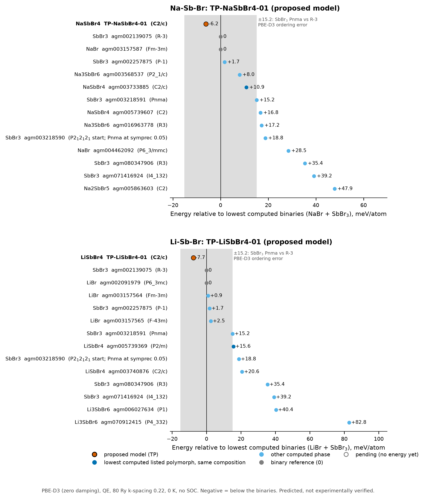
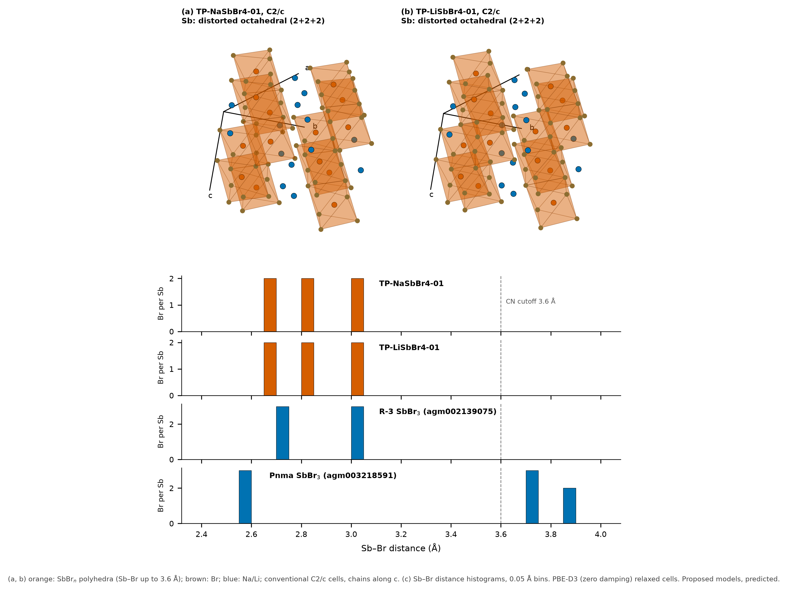

# Project Halide

Predicted crystal-structure models for two sodium and lithium antimony bromides, NaSbBr4 and LiSbBr4, found with a machine-learned potential screen and checked with Quantum ESPRESSO (PBE-D3). By Nikhilesh Suravarjjala and Arnav Kakani.

[](LICENSE)
[](https://doi.org/10.17172/nomad.j0ce-ctz1)
[](https://doi.org/10.17172/nomad.7c09-m7v2)
[](https://doi.org/10.5281/zenodo.23481926)

<p align="center">
  
</p>

## What this project is

Solid halides are studied as possible battery electrolytes. We asked a narrow question: can a cheap machine-learned screen propose structures for compositions with no reported crystal structure, and do those structures hold up under a proper DFT check?

We moved known AMX4 structure types onto new chemistries, ranked the results with the MACE-MPA-0 potential, and sent the survivors through five gates in Quantum ESPRESSO. Two models, TP-NaSbBr4-01 and TP-LiSbBr4-01, went through the full set of checks and are the ones we published. The structures are predictions. Nothing here has been synthesized or measured, and no electrolyte is claimed.

## Where the work lives

| What | Where |
|---|---|
| Raw DFT inputs and outputs (v2) | NOMAD, [10.17172/nomad.j0ce-ctz1](https://doi.org/10.17172/nomad.j0ce-ctz1) |
| Earlier validation dataset (v1, not a discovery claim) | NOMAD, [10.17172/nomad.7c09-m7v2](https://doi.org/10.17172/nomad.7c09-m7v2) |
| Code archive | Zenodo, [10.5281/zenodo.23481926](https://doi.org/10.5281/zenodo.23481926) |
| NOMAD project page | [nomad-lab.eu](https://nomad-lab.eu/prod/v1/gui/v2/projects/Wozh3Uq0Rb-XVLm9aW3XLQ) |
| This repository | Screening code, gate logic, figure scripts, small reports |

## Results

| Item | Result |
|---|---|
| Screen | MACE-MPA-0 screened structure transplants into AMX4 chemistries |
| Energy gates | Seven compositions pass the energy gates (PBE-D3) |
| Deeper checks | Two models went through convergence, dispersion and phonon checks |
| NaSbBr4 model | 6.2 meV/atom below NaBr + SbBr3; 17.0 meV/atom below the lowest computed listed NaSbBr4 |
| LiSbBr4 model | 7.7 meV/atom below LiBr + SbBr3; 23.3 meV/atom below the lowest computed listed LiSbBr4 |
| Phonons | No imaginary mode at 2x2x2 sampling for either model |

Settings: PBE-D3 zero damping, 80 Ry, k-spacing 0.22, 0 K, no spin-orbit coupling. Numbers come from `paper/claims.json`, generated from `discovery/results/verdict.json`.

<p align="center">
  
</p>

## The five gates

- G1: the ML hit survives a rattle-and-relax check (MACE + D3).
- G2: DFT puts it below every listed Alexandria structure of the same composition.
- G3: DFT puts it below all tested competing phases.
- G4: the G2 and G3 signs hold at a higher cutoff or denser k-mesh.
- G5: DFT phonons show no imaginary modes.

`discovery/scripts/verdict.py` applies G2 to G4 to the pw.x outputs.

## Limitations

- The margins are small. PBE-D3 mis-orders the SbBr3 polymorphs by 15.2 meV/atom, which is larger than the margin over the binaries.
- With plain PBE (no dispersion), the LiSbBr4 model lies 2.0 meV/atom above its competing phases.
- Harmonic phonons at 2x2x2 sampling showing no imaginary mode does not by itself establish dynamical stability.
- No ion transport is shown. MACE molecular dynamics (50 to 150 ps, 300 to 600 K) found no long-range ion diffusion in the pristine crystals.
- Sb(III) is expected to be reduced at Li and Na anode potentials.
- Being below computed competitors does not make these phases. They are candidates for diffraction testing.
- Nothing has been synthesized.

## Reproduce

This repository holds code and small reports. Raw DFT outputs and pseudopotentials are not included.

```bash
pip install -r requirements-ml.lock phonopy==4.8.3     # Python 3.11
# download the NOMAD v2 files and unzip to halide_models_v2/ (see REPRODUCE.md, step 3)
python -I discovery/scripts/verdict.py                 # ends with "self-check OK"
```

Full steps, including the stability window and figure scripts, are in [`REPRODUCE.md`](REPRODUCE.md). DFT used Quantum ESPRESSO 7.5 with pslibrary 1.0.0 PAW pseudopotentials.

| Path | What |
|---|---|
| `discovery/scripts/` | screening (`transplant_scan.py`, `screen_mace.py`), gate logic (`verdict.py`), stability window (`window.py`) |
| `discovery/candidates/`, `discovery/results/` | candidate structures, gate and window reports |
| `overnight/` | DFT job generators, batch runner, QE build script |
| `paper/` | claim extraction and figure scripts |

## How to cite

Cite the data with the NOMAD record and the code with [`CITATION.cff`](CITATION.cff):

Suravarjjala, N., & Kakani, A. (2026). *Predicted crystal structure models for NaSbBr4 and LiSbBr4 from a prototype-transplant search (PBE-D3), with controls and negative results (v2)* [Data set]. NOMAD. https://doi.org/10.17172/nomad.j0ce-ctz1

## Thanks

To the collaborators who contributed cluster and laptop compute time.

## Licence

Code: MIT ([`LICENSE`](LICENSE)).
