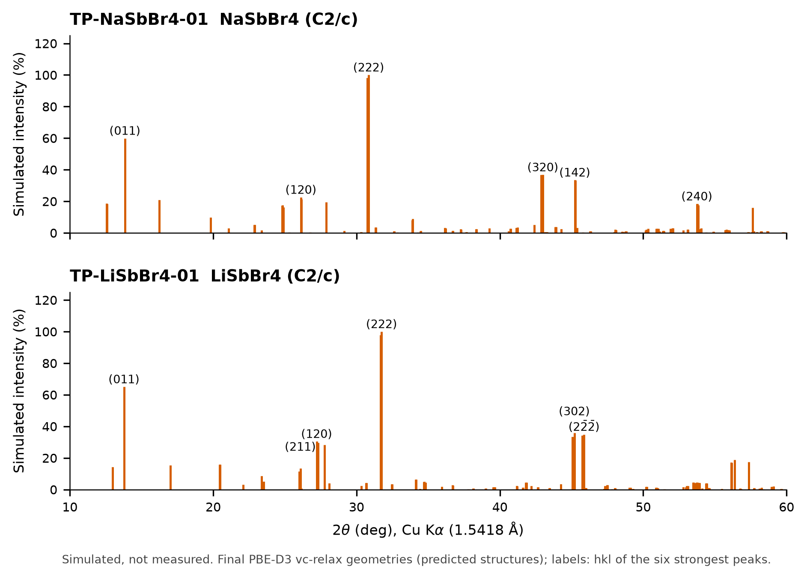

**Keywords:** halide solid electrolyte, crystal structure prediction, density functional theory, machine-learned interatomic potential, convex hull

## Abstract

Many ternary halides studied for solid-state batteries have no reported crystal structure. Their computed stability then depends on whichever structure is assumed, so the 3D crystal structure is the bottleneck. We transplanted {{search.n_prototypes}} prototypes from the Alexandria database into AMX~4~ chemistries (A = Li, Na; M = Al, Ga, In, Sc, Y, Sb, Bi; X = Cl, Br, I; {{search.n_transplants}} transplants) and screened them with the MACE-MPA-0 machine-learned potential. We then compared the best survivors with every database-listed polymorph and competing phase we computed, using PBE-D3. The main result is a proposed C2/c model, TP-NaSbBr4-01, predicted {{na_comp|abs.1f}} meV/atom below NaBr + SbBr~3~ and {{na_dE_listed|abs.1f}} meV/atom below the lowest computed NaSbBr~4~ polymorph listed in Alexandria. The sign holds with D3(BJ), with the nonlocal vdW-DF-optB86b functional and without dispersion. Harmonic phonons at {{na_ph_supercell}} sampling show no imaginary mode, which does not by itself establish dynamical stability. A secondary candidate with less evidence, TP-LiSbBr4-01, lies below its competing phases with D3 zero damping, D3(BJ) and optB86b ({{li_comp|abs.1f}}, {{li_hull_bj|abs.1f}} and {{li_hull_ob86|abs.1f}} meV/atom). With plain PBE, it lies {{li_hull_none|+.2f}} meV/atom above them. Its phonons at {{li_ph_supercell}} sampling also show no imaginary mode. The method's own errors are as large as or larger than these margins. PBE-D3 mis-orders the SbBr~3~ polymorphs by {{T1.sbbr3_order.zero|+.1f}} meV/atom, and optB86b mis-orders them by {{sbbr3_order_ob86|+.1f}} meV/atom (with PBE-generated PAW datasets), so the error is not a D3 artifact. {{?control.status=done}}The protocol also fails its one false-positive control. It ranks a hypothetical LiAlBr~4~ model {{control.lialbr4.zero|abs.1f}} meV/atom below a LiAlBr~4~ cell built on the LiAlCl~4~ structure type.{{:}}The protocol was not tested at the DFT level on a known structure.{{/?}} At this level of theory, both models are candidates for diffraction testing. Their position below the computed binaries does not establish them as phases. No electrolyte suitability is shown. Nothing was synthesized. Machine-learned molecular dynamics found no long-range ion diffusion in the pristine crystals. Sb(III) is expected to be reduced at Li and Na anode potentials. {{?window_NaSbBr4}}{{?window_LiSbBr4}}The computed 0 K PBE-D3 windows are narrow ({{win_lo_NaSbBr4|.2f}}–{{win_hi_NaSbBr4|.2f}} V vs Na/Na^+^, {{win_lo_LiSbBr4|.2f}}–{{win_hi_LiSbBr4|.2f}} V vs Li/Li^+^). They lie above the metal potential and below common cathodes, and the oxidation limit is an upper bound. The PBE gaps ({{gap_NaSbBr4|.1f}} and {{gap_LiSbBr4|.1f}} eV) are underestimates.{{:}}The electrochemical window and band-gap calculations were not complete at the time of writing.{{/?}}{{:}}The electrochemical window and band-gap calculations were not complete at the time of writing.{{/?}} Models in five other screened compositions, including NaBiCl~4~, also meet all four gates (one machine-learned, three DFT). They did not receive the dispersion, phonon and window checks, so they are reported briefly and not pursued.

## 1. Introduction

Halide solid electrolytes such as Li~3~YCl~6~, Li~3~YBr~6~ and Li~3~InCl~6~ have drawn interest for their ionic conductivity and oxidative stability [@Asano2018; @Wang2019; @Li2019]. Any computed property of a halide, from formation energy to migration barrier to diffraction pattern, depends on the crystal structure assumed for it. For many candidate compositions no structure has been reported, so the 3D crystal structure is the bottleneck. Many A–M–X compositions are absent from structure databases or appear only as hypothetical entries built from a few prototypes. Such a composition can look unstable only because its assumed structure is poor. Substitution into known structure types [@Hautier2011] and large machine-learning searches [@Merchant2023] address this issue. However, absence from one database, or a machine-learned energy below a hull, is not evidence of a new or synthesizable material [@Cheetham2024; @Bartel2022].

These approaches leave three gaps. First, database and high-throughput convex hulls [@Jain2013; @Schmidt2023] rank only the structures they list. A composition with no reported structure therefore gets a stability that depends on whichever prototype was assumed for it. Second, large machine-learned sets [@Merchant2023] are evaluated with DFT but are not checked entry by entry for novelty or credibility. A perspective on one such set [@Cheetham2024] questioned whether many of its entries are new, credible or useful. Third, structure predictions are rarely reported together with their failures, controls and method error, although computed formation energies alone are a weak guide to stability [@Bartel2022].

Our workflow addresses these gaps on a small scale. It searches many prototypes per composition by transplanting them into the target chemistry. It then re-checks each hit with DFT gates against every listed polymorph and competing phase we computed, at one fixed setting. It includes a false-positive control and an explicit estimate of the method error. A script generates a ledger of the DFT gates, released with the data and code. It does not remove the method error, which is as large as the margins found (Section 3.5).

This paper predicts structures and does not claim conduction, synthesis or a new compound. The Sb(III) bromides that came out of the search are reducible at Li and Na anode potentials, so the electrolyte motivation above applies to the search, not to these two results (Section 4). We use "proposed model" for a computed structure never compared with experiment and "lowest" for lowest among the structures we computed at the stated level of theory. A "transplant" (prefix TP-) is a prototype-substitution structure, and "listed" marks a polymorph already present in the Alexandria database. A "hit" is a transplant kept by the machine-learned screen, and a "gate" is a screening criterion. Harmonic phonons of both models show no imaginary mode at the sampling used. Several checks remain open. We computed no finite-temperature free energies. Of the crystallographic databases, we searched only ICSD, which has no Na–Sb–Br or Li–Sb–Br ternary compound (Limitation 7). Both structures are therefore predicted, proposed models.

## 2. Methods

### 2.1 Prototype-transplant search

From the Alexandria PBE database [@Schmidt2023] we took all A'M'X'~4~ entries with at most 24 atoms per cell ({{search.n_entries}} entries). We grouped the entries within 30 meV/atom of the Alexandria hull into {{search.n_prototypes}} distinct prototypes with a role-preserving structure comparison, in which A', M' and X' map onto fixed sites. We decorated each prototype with each target chemistry and scaled it to the mean volume per atom of that composition's Alexandria entries, giving {{search.n_transplants}} transplants. We skipped chemistry–prototype pairs already listed in Alexandria and dropped several iodide chemistries for lack of time.

### 2.2 Machine-learned screening and rattle gate (G1)

We relaxed every transplant with MACE-MPA-0 [@Batatia2022; @Batatia2023] (medium model, float64; FIRE with a Fréchet cell filter, f~max~ = 0.01 eV/Å) in ASE [@Larsen2017]. The {{search.n_ml_d3}} transplants that lay within 15 meV/atom of the best listed entry and matched no listed entry (pymatgen StructureMatcher [@Ong2013]) were relaxed again with MACE-MPA-0 plus D3(BJ) [@Grimme2010; @Grimme2011]. We kept the {{search.n_hits}} that ended at least 3 meV/atom below the best listed entry and relaxed all listed entries of each hit chemistry with the same settings.

For gate G1, we displaced the best hit per chemistry, its lowest listed polymorphs and the reference phases by random 0.03 Å offsets and relaxed them again. A hit survived if it returned to its own structure, matched no listed entry, and stayed at least 5 meV/atom below the best listed structure and at least 3 meV/atom below AX + MX~3~. We added this rattle step because several Alexandria entries sat on saddle points and relaxed downward when displaced, which shrinks apparent margins.

At the machine-learned level we checked whether the search recovers four tetrahalides that our literature search listed as having known structures ({{search.val_names}}; space group and cell size only). It recovered {{search.val_recovered}} of {{search.val_total}} and missed LiAlBr~4~, where it preferred a model {{search.val_lialbr4_miss}} meV/atom below a cell built on the LiAlCl~4~ structure type. This is a weak validation, and the miss is as large as the margins reported below. {{?control.status=done}}We therefore repeated the LiAlBr~4~ comparison at the DFT level (Section 3.5, Table 1C).{{:}}We did not repeat this comparison at the DFT level (Limitation 1).{{/?}}

### 2.3 DFT gates (G2–G4) and prior-art check

All DFT calculations used Quantum ESPRESSO pw.x 7.5 [@Giannozzi2009; @Giannozzi2017] with PBE [@Perdew1996] and Grimme D3 [@Grimme2010] through `vdw_corr='dft-d3'` (zero damping, code defaults). We used PSlibrary 1.0.0 scalar-relativistic PAW datasets [@DalCorso2014], Gaussian smearing of 0.005 Ry, ecutrho = 8 × ecutwfc and Monkhorst–Pack meshes with a k-point spacing of at most 0.22 Å^−1^. Variable-cell BFGS relaxations used `conv_thr` 10^−8^ Ry, forces 10^−3^ Ry/bohr and pressure 0.5 kbar, with no imposed symmetry. The base setting for both systems is 80 Ry (ecutrho 640 Ry) with a k-spacing of at most 0.22 Å^−1^, written "{{na_setting}}" below. Energies are the final SCF on a fresh plane-wave basis, not the BFGS enthalpy. Every comparison uses one setting for all phases.

- G2: the model is below every listed Alexandria polymorph of the same composition that we computed.
- G3: the model is below every computed competing phase or combination (binaries and listed ternaries on the pseudo-binary line, lowest computed polymorph of each reference).
- G4: G2 and G3 keep their sign at a k-spacing of 0.17 Å^−1^ and, for these two systems, at 100 Ry. G4 is a numerical convergence test only.

G1 is a machine-learned criterion, and G2–G4 are PBE-D3 criteria. Separately from the gates, a literature and database search looked for a published structure of each composition. Limitation 7 states what the search did and did not cover. We assigned space groups to structures relaxed without symmetry with pymatgen's SpacegroupAnalyzer (spglib, symprec 0.05 Å).

The script `discovery/scripts/verdict.py` reads every pw.x output and makes the G2–G4 decisions. G1 and the literature search are recorded, not recomputed. `paper/claims.py` turns its output into the ledger that fills every number in this paper. A control energy was reproduced to all printed digits on a computing cluster and on two separately compiled laptop builds (v1 dataset [@NomadV1]).

### 2.4 Competing phases and dispersion

The competing set for each system holds every Alexandria Na–Sb–Br or Li–Sb–Br phase near the Alexandria hull plus the experimentally reported polymorphs. These are SbBr~3~ in R-3 and P-1 cells and the two experimentally reported orthorhombic forms [@CushenHulme1962; @CushenHulme1964], started from Alexandria entries agm003218591 (Pnma) and agm003218590 (P2~1~2~1~2~1~); NaBr rocksalt; LiBr rocksalt, zincblende and wurtzite; Na~3~SbBr~6~, Na~2~SbBr~5~ and Li~3~SbBr~6~ cells; and every listed NaSbBr~4~ and LiSbBr~4~ polymorph we could relax. To test the dependence on dispersion, we fully re-relaxed (variable cell) the following with D3(BJ) and without dispersion: the models, the lowest D3-zero listed polymorph of each composition, the binaries and, for NaSbBr~4~, the Na~3~SbBr~6~ and Na~2~SbBr~5~ cells (Table 1). No energy in those columns comes from a frozen geometry. Only the lowest D3-zero listed polymorph was recomputed in the BJ and no-dispersion columns, so another listed polymorph could become the lowest there. As a third dispersion treatment, we used the nonlocal vdW-DF-optB86b functional [@Klimes2011] (`input_dft='vdw-df-ob86'`), which is not a pairwise add-on. We re-relaxed (variable cell, starting from the PBE-D3 geometries, {{na_setting}}) the models, the lowest listed polymorph of each composition, NaBr, rocksalt and wurtzite LiBr, the R-3 and Pnma-start SbBr~3~ cells, and the Na~3~SbBr~6~, Na~2~SbBr~5~ and Li~3~SbBr~6~ cells. These runs use the same PAW datasets as the PBE runs (Limitation 2). We also re-relaxed the lowest listed LiSbBr~4~ polymorph without dispersion. We also measured the method error directly as the energy of the experimentally observed polymorphs of SbBr~3~ and LiBr (rocksalt) relative to the polymorph that PBE-D3 ranks lower.

### 2.5 Phonons and molecular dynamics

We computed harmonic phonons of TP-NaSbBr4-01 by finite displacement with phonopy [@Togo2023] in a {{na_ph_supercell}} supercell. Forces came from pw.x with the same functional and pseudopotentials (tighter SCF threshold, 3×3×3 k-mesh). The residual force of the undisplaced supercell exceeded our 0.01 Ry/bohr gate, so we subtracted it from every displaced set. That gate applies to the total-force norm over all atoms of the supercell, so the residual per atom is about an order of magnitude smaller. Of the 18 displacements, 16 come in ± pairs, which cancel the residual exactly. Omitting the subtraction changes the frequency minima by less than 0.003 THz (`discovery/results/audit_oct17/phonon_review.md`). We evaluated frequencies on a 16^3^ mesh with a tolerance of {{na_ph_tol}} THz. We computed TP-LiSbBr4-01 phonons the same way, in a {{li_ph_supercell}} supercell. Its 18 displacements and the undisplaced cell were run on three machines with identical pw.x inputs and settings, which `tools/assemble_lisbbr4_phonons.py` checks before assembling the force sets.

SI Note S1 describes the machine-learned molecular dynamics, which supports no claim in this paper.

## 3. Results

### 3.1 Search funnel

Of {{search.n_transplants}} transplants, {{search.n_ml_d3}} were close enough to the best listed entry to be relaxed with D3 and {{search.n_hits}} were kept as hits. The best hit per chemistry went through G1 and then DFT. In all, {{search.n_dft_models}} models in {{search.n_dft_formulas}} compositions reached DFT, including two higher-energy NaBiCl~4~ transplants and the LiAlBr~4~ control model. The lithium models TP-LiBiCl4-01, TP-LiSbCl4-03 and TP-LiInCl4-01 failed G3 against their binaries. Models in {{search.n_gate_pass}} compositions meet G1–G4 as computed by `verdict.py`: NaSbBr~4~, LiSbBr~4~, NaBiCl~4~, NaSbCl~4~, LiBiBr~4~, NaBiBr~4~ and LiYBr~4~. Passing the gates is weak evidence, because the gate margins are comparable to the method error (Section 3.5). We defend only two of these models, TP-NaSbBr4-01 and TP-LiSbBr4-01. Both are C2/c transplants of a TlAlCl~4~-type Alexandria prototype (agm078380533), and only these two received the full follow-up of phonons, other dispersion treatments and an electrochemical window. Section 3.7 reports the others briefly. They are not pursued here. Both results are relative to the phases we had computed when the numbers were frozen{{?n_pending}}. At that point, {{n_pending}} competing phases were still running (Limitation 4){{:}}{{/?}}.

### 3.2 TP-NaSbBr4-01

At {{na_setting}}, TP-NaSbBr4-01 is {{na_dE_listed|.1f}} meV/atom relative to the lowest computed listed NaSbBr~4~ ({{na_listed_id}}) and {{na_comp|.1f}} meV/atom relative to {{na_route}} (Figure 1a; structure in Section 3.4). It is the only computed Na–Sb–Br ternary below NaBr + SbBr~3~. The other computed ternaries on the NaBr–SbBr~3~ line (the listed NaSbBr~4~ polymorphs, Na~3~SbBr~6~ and Na~2~SbBr~5~) lie {{na_tern_min|+.1f}} to {{na_tern_max|+.1f}} meV/atom above it. The margins do not change at a k-spacing of 0.17 Å^−1^ ({{na_dE_listed_k017|.1f}} and {{na_comp_k017|.1f}}) or at 100 Ry ({{na_dE_listed_100|.1f}} and {{na_comp_100|.1f}}).

Both NaSbBr~4~ margins keep their sign across the four treatments tested (Table 1). Three are PBE with D3 zero damping, D3(BJ) or no dispersion, and the fourth is the nonlocal vdW-DF-optB86b functional. All four use one PAW family. Against NaBr + SbBr~3~, the margin is {{T1.na_bin.zero|.1f}}, {{T1.na_bin.bj|.1f}} and {{T1.na_bin.none|.1f}} meV/atom with D3 zero damping, D3(BJ) and no dispersion. Against the tightest computed decomposition in each column, it is {{na_comp|.1f}}, {{na_hull_bj|.1f}} and {{na_hull_none|.1f}} meV/atom. Without dispersion, that route is Na~3~SbBr~6~ + SbBr~3~ rather than NaBr + SbBr~3~. Against the lowest listed polymorph, the margin is {{T1.na_listed.zero|.1f}}, {{T1.na_listed.bj|.1f}} and {{T1.na_listed.none|.1f}} meV/atom. With optB86b, the two margins are {{na_hull_ob86|.1f}} meV/atom (tightest computed decomposition) and {{na_dE_listed_ob86|.1f}} meV/atom (lowest listed polymorph).

DFT phonons show no imaginary mode at {{na_ph_supercell}} sampling. The lowest frequency on the interpolated mesh is {{na_ph_mesh_min|+.3f}} THz ({{na_ph_away_gamma|+.3f}} THz away from Γ), and the lowest at a commensurate non-Γ point is {{na_ph_comm_min|+.3f}} THz (Figure 2). This result does not establish dynamical stability, because a {{na_ph_supercell}} supercell of a 12-atom cell cannot resolve long-wavelength soft modes and the residual-force gate failed before subtraction.

Figure 3a compares the simulated powder pattern of TP-NaSbBr4-01 with that of the lowest listed polymorph. The two differ at low angle, where the listed polymorph has a lowest-angle reflection that the model lacks. A diffraction experiment would test these low-angle reflections first.

### 3.3 TP-LiSbBr4-01 (secondary candidate)

TP-LiSbBr4-01 has less evidence than TP-NaSbBr4-01. Its competing-phase margin depends on dispersion, and with plain PBE it lies above its competing phases. At {{li_setting}}, TP-LiSbBr4-01 is {{li_dE_listed|.1f}} meV/atom relative to the lowest computed listed LiSbBr~4~ ({{li_listed_id}}) and {{li_comp|.1f}} meV/atom relative to {{li_route}} (Figure 1b). The k-spacing check gives {{li_dE_listed_k017|.1f}} and {{li_comp_k017|.1f}}. At 100 Ry, the margins are {{li_dE_listed_100|.1f}} and {{li_comp_100|.1f}}.

A second listed LiSbBr~4~ entry, agm003740876, has the same space group, cell size and Wyckoff sequence as the model. Relaxed with the same settings, it lies {{li_listed2_gap|.1f}} meV/atom above TP-LiSbBr4-01. pymatgen StructureMatcher (species-aware, volume scaling on) finds no match between the two at the default tolerances (ltol 0.2, stol 0.3, angle 5°) or at 0.3/0.5/10°. At 0.5/0.7/15° they match with a root-mean-square displacement of {{struct.li_vs_listed2.rms_A|.3f}} Å. We read them as related structures with the same layer or chain motif and different stacking, not as duplicates (Section 3.4).

The LiSbBr~4~ margin depends on dispersion through the LiBr reference (Table 1). PBE-D3 ranks wurtzite LiBr {{T1.libr_order.zero|.1f}} meV/atom below the experimental rocksalt form. With D3(BJ), rocksalt is lower by {{T1.libr_order.bj|abs.1f}} meV/atom. Plain PBE puts rocksalt {{T1.libr_order.none|+.1f}} meV/atom above wurtzite. Against rocksalt LiBr + SbBr~3~, the model stays below with D3 zero damping, D3(BJ) and no dispersion ({{T1.li_rs.zero|.1f}}, {{T1.li_rs.bj|.1f}} and {{T1.li_rs.none|.1f}} meV/atom). Against its tightest computed decomposition, it stays below with D3 zero damping, D3(BJ) and optB86b ({{li_comp|.1f}}, {{li_hull_bj|.1f}} and {{li_hull_ob86|.1f}} meV/atom). Without dispersion, it lies {{li_hull_none|+.2f}} meV/atom above wurtzite LiBr + SbBr~3~. Plain PBE also mis-orders LiBr (Table 1B), so this sign change may come from the LiBr reference. We do not discount it, and it is one reason TP-LiSbBr4-01 is the secondary candidate. Against the lowest listed polymorph, the margin is {{T1.li_listed.bj|.1f}} meV/atom with D3(BJ), {{li_dE_listed_ob86|.1f}} with optB86b and {{li_dE_listed_none|.1f}} without dispersion.

DFT phonons of TP-LiSbBr4-01 show no imaginary mode at {{li_ph_supercell}} sampling. The lowest frequency on the interpolated mesh is {{li_ph_mesh_min|+.3f}} THz ({{li_ph_away_gamma|+.3f}} THz away from Γ), and the lowest at a commensurate non-Γ point is {{li_ph_comm_min|+.3f}} THz. As for TP-NaSbBr4-01, this result does not establish dynamical stability. Figure 3b gives its simulated powder pattern next to the lowest listed polymorph.

**Table 1.** Dispersion sensitivity of the proposed-model margins (A), PBE ordering errors of reference polymorphs (B){{?control.status=done}} and the LiAlBr~4~ false-positive control (C){{:}}{{/?}}, in meV/atom ({{na_setting}}, 0 K, no SOC). A: negative = model lower; the "tightest computed decomposition" rows give the G3 number directly. B: energy of the experimental polymorph minus the polymorph the method ranks lower; positive = wrong order. Generated in `paper/figures/data/T1_method_error.md`, which lists the source output files for every cell. The optB86b column and the no-dispersion listed-LiSbBr~4~ cell come from `paper/claims.json` (jobs in `overnight/m5_disp3`); "not computed" means that no calculation exists for that cell.

| Quantity | PBE-D3 (zero) | PBE-D3(BJ) | PBE (no D3) | optB86b-vdW |
|---|---|---|---|---|
| A. TP-NaSbBr4-01 vs NaBr + SbBr~3~ | {{T1.na_bin.zero|+.2f}} | {{T1.na_bin.bj|+.2f}} | {{T1.na_bin.none|+.2f}} | {{nonlocal.T1.na_bin|+.2f}} |
| A. TP-NaSbBr4-01 vs tightest computed decomposition | {{na_comp|+.2f}} | {{na_hull_bj|+.2f}} | {{na_hull_none|+.2f}} | {{na_hull_ob86|+.2f}} |
| A. TP-NaSbBr4-01 vs lowest listed NaSbBr~4~ | {{T1.na_listed.zero|+.2f}} | {{T1.na_listed.bj|+.2f}} | {{T1.na_listed.none|+.2f}} | {{na_dE_listed_ob86|+.2f}} |
| A. TP-LiSbBr4-01 vs lowest LiBr + SbBr~3~ | {{T1.li_bin.zero|+.2f}} | {{T1.li_bin.bj|+.2f}} | {{T1.li_bin.none|+.2f}} | {{nonlocal.T1.li_bin|+.2f}} |
| A. TP-LiSbBr4-01 vs tightest computed decomposition | {{li_comp|+.2f}} | {{li_hull_bj|+.2f}} | {{li_hull_none|+.2f}} | {{li_hull_ob86|+.2f}} |
| A. TP-LiSbBr4-01 vs rocksalt LiBr + SbBr~3~ | {{T1.li_rs.zero|+.2f}} | {{T1.li_rs.bj|+.2f}} | {{T1.li_rs.none|+.2f}} | {{nonlocal.T1.li_rs|+.2f}} |
| A. TP-LiSbBr4-01 vs wurtzite LiBr + SbBr~3~ | {{T1.li_wz.zero|+.2f}} | {{T1.li_wz.bj|+.2f}} | {{T1.li_wz.none|+.2f}} | {{nonlocal.T1.li_wz|+.2f}} |
| A. TP-LiSbBr4-01 vs lowest listed LiSbBr~4~ | {{T1.li_listed.zero|+.2f}} | {{T1.li_listed.bj|+.2f}} | {{li_dE_listed_none|+.2f}} | {{li_dE_listed_ob86|+.2f}} |
| B. SbBr~3~: orthorhombic (expt, Pnma start) − R-3 | {{T1.sbbr3_order.zero|+.2f}} | {{T1.sbbr3_order.bj|+.2f}} | {{T1.sbbr3_order.none|+.2f}} | {{sbbr3_order_ob86|+.2f}} |
| B. SbBr~3~: orthorhombic (expt, P2~1~2~1~2~1~ start) − R-3 | {{sbbr3_alt_order|+.2f}} | not computed | not computed | not computed |
| B. LiBr: rocksalt (expt) − wurtzite | {{T1.libr_order.zero|+.2f}} | {{T1.libr_order.bj|+.2f}} | {{T1.libr_order.none|+.2f}} | {{nonlocal.T1.libr_order|+.2f}} |
{{?control.status=done}}| C. LiAlBr~4~: ML-preferred model − LiAlCl~4~-type cell (Br) | {{control.lialbr4.zero|+.2f}} | {{control.lialbr4.bj}} | not computed | not computed |
{{?control.naalcl4.zero}}| C. NaAlCl~4~: best transplant − experimental structure | {{control.naalcl4.zero}} | {{control.naalcl4.bj}} | not computed | not computed |
{{:}}{{/?}}{{:}}{{/?}}

### 3.4 Structures of the proposed models

Table 2 gives the PBE-D3 (0 K) lattice parameters, volume per formula unit, Z and Wyckoff positions of both models and of their lowest listed polymorphs. Figure 4 shows polyhedral views and the Sb–Br distance distributions, and the SI contains CIFs of all five structures in Table 2.

The prototype is TlAlCl~4~-type, in which Al is tetrahedral. After relaxation, however, Sb is not tetrahedral. In TP-NaSbBr4-01, Sb is six-coordinate in a distorted octahedron with three pairs of bond lengths (2+2+2; Sb–Br {{struct.na.sbbr_min|.2f}}–{{struct.na.sbbr_max|.2f}} Å, {{struct.na.sb_cn}} Br within {{struct.cn_cutoff_A|.1f}} Å). The SbBr~6~ octahedra share edges and form one-dimensional chains, and Na is {{struct.na.a_cn}}-coordinated. TP-LiSbBr4-01 has the same Sb environment (2+2+2; Sb–Br {{struct.li.sbbr_min|.2f}}–{{struct.li.sbbr_max|.2f}} Å) and the same edge-sharing chains, and Li is {{struct.li.a_cn}}-coordinated. For comparison, Sb in R-3 SbBr~3~ is also six-coordinate (3+3), in edge-sharing layers. In the experimental Pnma cell, Sb is three-coordinate (trigonal pyramidal) in isolated SbBr~3~ molecules. Its secondary Sb···Br contacts at {{pnma_contacts}} Å lie beyond the {{struct.cn_cutoff_A|.1f}} Å cutoff. The models and R-3 SbBr~3~ share extended Sb–Br connectivity that the molecular orthorhombic SbBr~3~ lacks, so the same functional bias may lower all of them (Section 3.5).

StructureMatcher at default tolerances matches neither model to the lowest listed polymorph of its composition. For NaSbBr~4~ (agm003733885), a match appears only at 0.5/0.7/15°, with a root-mean-square displacement of {{struct.na_vs_listed.rms_A|.3f}} Å. For LiSbBr~4~, the lowest listed polymorph ({{li_listed_id}}, P2/m, Z = 1) gives no match up to 1.0/1.5/30°. The second listed entry, agm003740876, matches only at 0.5/0.7/15° ({{struct.li_vs_listed2.rms_A|.3f}} Å; Section 3.3).

**Table 2.** Structures of the proposed models and their lowest listed polymorphs (PBE-D3 zero damping, {{na_setting}}, 0 K, relaxed without symmetry; space groups at symprec 0.05 Å). Generated in `paper/figures/data/T2_structures.md`.

{{include:T2_structures.md}}

### 3.5 Method error versus margins

PBE-D3 ranks two hypothetical SbBr~3~ cells, R-3 and P-1 ({{sbbr3_p1|+.1f}} meV/atom above R-3), below both experimentally reported orthorhombic forms [@CushenHulme1962; @CushenHulme1964]. The orthorhombic cells lie {{T1.sbbr3_order.zero|+.1f}} (started from Pnma, agm003218591) and {{sbbr3_alt_order|+.1f}} meV/atom (started from P2~1~2~1~2~1~, agm003218590) above R-3. At symprec 0.05 Å, the symmetry finder assigns Pnma to both relaxed orthorhombic cells. At 0.001 Å, however, the P2~1~2~1~2~1~-start cell keeps P2~1~2~1~2~1~ symmetry and StructureMatcher does not match it to the Pnma-start cell, so the two are distinct structures. We label them by their starting cells and use the lower one in Table 1B. This ordering error is larger than the shift of the SbBr~3~ reference that would flip either competing-phase margin ({{na_sbbr3_flip|.1f}} meV/atom for NaSbBr~4~ and {{li_sbbr3_flip|.1f}} meV/atom for LiSbBr~4~; Section 5). The ordering error is {{T1.sbbr3_order.bj|+.1f}} with D3(BJ) and {{T1.sbbr3_order.none|+.1f}} without dispersion. With the nonlocal optB86b functional, the Pnma-start cell still lies {{sbbr3_order_ob86|+.1f}} meV/atom above R-3. The mis-ordering is therefore not an artifact of the D3 correction. We use the lowest computed SbBr~3~ as reference, so an error that only over-stabilizes that reference makes G3 stricter. However, the proposed models share six-coordinate Sb in an extended, edge-sharing Sb–Br network with R-3 SbBr~3~ (Section 3.4). If the same error also over-stabilizes the models, the margins could close. We therefore treat both competing-phase results as unresolved at this level of theory.

We do not derive an error bar on a ternary-from-binaries reaction energy from these data. They are one SbBr~3~ polymorph pair plus LiBr, whose ordering error changes sign with the dispersion treatment. The band in Figure 1 shows the size of the SbBr~3~ mis-ordering for scale, not a confidence interval.

{{?control.status=done}}**False-positive control.** At the machine-learned level, the search preferred a hypothetical LiAlBr~4~ model {{search.val_lialbr4_miss}} meV/atom below a cell built on the LiAlCl~4~ structure type (Section 2.2). LiAlCl~4~ crystallizes in P2~1~/c [@Perenthaler1982]. We built this reference from the LiAlCl~4~-type P2~1~/c Alexandria entry agm003231472 by replacing Cl with Br. We did not check the resulting cell against a published LiAlBr~4~ structure, so this control is weaker than a test against experimental coordinates. Relaxed with the G2/G3 protocol ({{control.setting}}), the ML-preferred model lies {{control.lialbr4.zero|abs.1f}} meV/atom below this LiAlCl~4~-type cell in PBE-D3 with D3 zero damping (Table 1C). We did not compute the 36-atom Alexandria LiAlBr~4~ entry agm081834437. The protocol fails this control. The DFT gates used here admit a false positive of this size, which is comparable to the NaSbBr~4~ and LiSbBr~4~ competing-phase margins. {{?control.naalcl4.zero}}For NaAlCl~4~, which the search recovered, the corresponding numbers are {{control.naalcl4.zero|+.1f}} and {{control.naalcl4.bj|+.1f}} meV/atom.{{:}}No positive control (a recovered composition) was run at the DFT level.{{/?}}{{:}}**No DFT-level false-positive control.** At the machine-learned level, the search preferred a hypothetical LiAlBr~4~ model {{search.val_lialbr4_miss}} meV/atom below a cell built on the LiAlCl~4~ structure type (Section 2.2). We did not repeat that comparison with PBE-D3, so we cannot say whether the DFT gates would have rejected this false positive. Its size is comparable to the G2 margins reported here.{{/?}}

### 3.6 Dynamics

Machine-learned molecular dynamics showed no long-range diffusion of the mobile ion in either model (SI Note S1). It is a negative observation only (Section 4) and supports no positive transport claim.

### 3.7 Screened, not pursued

These other models are not claimed:

- **NaBiCl~4~**, a compound reported in the NaCl–BiCl~3~ phase-analysis literature (see [@Dzeranova2007] and references therein), meets G1–G4. Its search gave two near-degenerate PBE-D3 models whose order depends on D3. We did not compare them with the published diffraction data and make no claim.
- **NaSbCl~4~** passes G1–G4 with D3 zero damping but lies above NaCl + SbCl~3~ without dispersion. Its Na~2~SbCl~5~ competitor did not converge, and its phonons were inconclusive. We did not pursue it.
- **LiBiBr~4~** passes G1–G4 and stays below its binaries with both D3 variants, but by less than the method error. Without dispersion and with wurtzite LiBr, it lies above them. We did not pursue it.
- **LiBiCl~4~, LiSbCl~4~, LiInCl~4~** fail G3 against their binaries even though each beat its listed polymorphs. Large G2 margins can reflect weak database baselines rather than strong models.
- **LiYBr~4~ and NaBiBr~4~** pass G1–G4 with D3 zero damping (LiYBr~4~ by a thin margin against Li~3~YBr~6~). We ran no dispersion or phonon checks on them, so they are not claimed.
- **NaGaI~4~ and LiScBr~4~** were parked without complete comparisons, because the GaI~3~ and Li~3~ScBr~6~ references did not finish.

**Correction of the v1 framing.** Our earlier NOMAD dataset (v1, doi:10.17172/nomad.7c09-m7v2 [@NomadV1]) recomputed NaBiCl~4~, Li~2~CaBr~4~ and Li~2~CaCl~4~ in their Alexandria structures. It is a validation of reproducible energies, not a discovery. Its NaBiCl~4~ cell (agm005743614, C2/c) is not the lowest NaBiCl~4~ structure we later computed. The negative energy it reported against NaCl + BiCl~3~ used a BiCl~3~ reference that is not the lowest computed polymorph. With the lowest one, that cell lies above NaCl + BiCl~3~. Nothing in v1 should be read as a stability claim for NaBiCl~4~.

## 4. Battery relevance

**Why halides.** Inorganic solid electrolytes, halides among them, are studied as non-flammable alternatives to the organic liquid electrolytes in lithium-ion cells [@Li2020]. Li~3~YCl~6~ and Li~3~YBr~6~ reach ionic conductivities of order 10^−3^ S/cm (room temperature, cold-pressed pellet) [@Asano2018]. For Li chlorides and bromides, computed results (ab initio molecular dynamics and phase equilibria) predict fast ion conduction together with wide oxidation windows [@Wang2019]. That is the motivation for the search. It does not by itself make any structure in this paper a useful electrolyte.{{?window_NaSbBr4}}{{?window_LiSbBr4}} The windows computed below for the two Sb(III) bromides are narrow and do not share that property.{{:}}{{/?}}{{:}}{{/?}}

**What we computed.** For TP-NaSbBr4-01 and TP-LiSbBr4-01, we computed energies against the listed polymorphs and competing phases (Sections 3.2–3.3). For both models, we also ran a harmonic phonon check. It found no imaginary mode at {{na_ph_supercell}} sampling but does not establish dynamical stability (Sections 3.2–3.3). Without dispersion, TP-LiSbBr4-01 lies {{li_hull_none|+.2f}} meV/atom above its tightest computed decomposition (Table 1). None of these is a battery property.

**Electrochemical window and band gap.** We estimated the electrochemical stability window from the phase equilibria of the computed phases at fixed alkali chemical potential. This is the grand-potential approach [@Zhu2015; @Richards2016], used for Li in [@Wang2019]. We also computed the PBE band gap of each model. {{?window_NaSbBr4}}TP-NaSbBr4-01 window: {{window_NaSbBr4}}.{{:}}The TP-NaSbBr4-01 window was not complete at the time of writing.{{/?}} {{?window_LiSbBr4}}TP-LiSbBr4-01 window: {{window_LiSbBr4}}.{{:}}The TP-LiSbBr4-01 window was not complete at the time of writing.{{/?}} {{?gap_NaSbBr4}}{{?gap_LiSbBr4}}The PBE Kohn–Sham gaps (fixed occupation, D3) are {{gap_NaSbBr4|.2f}} eV for TP-NaSbBr4-01 and {{gap_LiSbBr4|.2f}} eV for TP-LiSbBr4-01. PBE underestimates gaps, so both models are predicted to be electronic insulators with larger true gaps.{{:}}The TP-LiSbBr4-01 band gap was not complete at the time of writing.{{/?}}{{:}}The band-gap calculations were not complete at the time of writing.{{/?}} The oxidation limit is an upper bound. The only oxidation products available were Br~2~, SbBr~3~ and the computed M~2~SbBr~6~ and MSbBr~6~ cells (M = Na, Li), and any phase we did not compute would lower it. A 0 K thermodynamic window also ignores kinetic stabilization and interphase formation. {{?window_NaSbBr4}}{{?window_LiSbBr4}}Both windows are narrow ({{win_width_NaSbBr4|.2f}} and {{win_width_LiSbBr4|.2f}} V wide). Their lower limits lie above the alkali-metal potential, so both models would be reduced at Li or Na metal and other low-voltage anodes. Their upper limits lie below the roughly 4 V of common layered-oxide cathodes. These windows do not indicate compatibility with standard cells.{{:}}{{/?}}{{:}}{{/?}}

**Ion transport.** Machine-learned molecular dynamics of the pristine crystals (SI Note S1) found {{md_both}}. Conduction in the defect-free crystals is therefore slow on that time scale. We did not study vacancies, aliovalent doping or disorder, which are how many halide conductors reach useful conductivity. The potential was also not validated against DFT for these compounds.

**Summary.** The two structures are DFT-predicted models and candidates for further study, not demonstrated electrolyte materials. A useful next step is to test whether either compound forms at all. Transport and electrochemistry come after that.{{?window_NaSbBr4}}{{?window_LiSbBr4}} The computed windows are narrow and would not support use against Li/Na metal or high-voltage cathodes without protective interlayers.{{:}}{{/?}}{{:}}{{/?}}

**Proposed experimental check.** The simplest test is to react NaBr (or LiBr) with SbBr~3~ in a 1:1 ratio and record a powder diffraction pattern. SbBr~3~ is moisture-sensitive, so the reaction needs an inert atmosphere. It may instead yield the unreacted binaries or SbBr~3~-rich phases. Figure 3 compares the simulated pattern of each model with its lowest listed polymorph. SI Figure S1 and `paper/figures/xrd_peaks.csv` give hkl-indexed peak lists of both models. A pattern that matches a model would support it. A pattern that shows only the binaries, a listed polymorph or an unknown phase would count against it.

## 5. Discussion

The method's own errors limit what this paper can claim. PBE-D3 mis-orders the SbBr~3~ polymorphs by {{T1.sbbr3_order.zero|+.1f}} meV/atom. The nonlocal optB86b functional mis-orders them by {{sbbr3_order_ob86|+.1f}} meV/atom with the same PBE-generated PAW datasets, so this error is not a D3 artifact. The protocol{{?control.status=done}} fails the one false-positive control by {{control.lialbr4.zero|abs.1f}} meV/atom{{:}} was not tested with a DFT-level false-positive control{{/?}}. The competing-phase margins are {{na_comp|abs.1f}} (NaSbBr~4~) and {{li_comp|abs.1f}} meV/atom (LiSbBr~4~). At this level of theory, a position below the computed binaries makes a model a candidate and nothing more. The margins against the listed polymorphs are larger. However, they are measured against hypothetical database entries, which can be weak baselines (Section 3.7). Convergence is not the limiting error, since the G4 checks moved no margin by more than {{g4_max_shift|.2f}} meV/atom. We therefore call both structures predicted, proposed models.

The two models do not have the same level of evidence. Both show no phonon instability at the sampling we could afford. TP-NaSbBr4-01, the main result, keeps its sign under all four treatments. TP-LiSbBr4-01 is a secondary candidate. It stays below its competing phases with all three dispersion treatments but not with plain PBE against wurtzite LiBr. All four treatments use semilocal or nonlocal GGA-level functionals and one PAW-PBE pseudopotential family.

Several results would falsify the models. One is a lower SbBr~3~ or NaBr polymorph not yet computed: a SbBr~3~ cell {{na_sbbr3_flip|.1f}} meV/atom below R-3 would flip the NaSbBr~4~ margin, and one {{li_sbbr3_flip|.1f}} meV/atom below would flip LiSbBr~4~. Others are a missing ternary such as Na~5~SbBr~8~ from GNoME [@Merchant2023], spin–orbit coupling or a second pseudopotential family that moves the margins by more than their size, and an experimental pattern that matches neither simulated pattern. We provide simulated powder patterns for both models so that an experimental group can test them directly.

## 6. Limitations

1. **Margins comparable to method error.** The competing-phase margins are smaller than the PBE-D3 SbBr~3~ ordering error (Table 1). {{?control.status=done}}The protocol fails the one DFT-level false-positive control (LiAlBr~4~, Table 1C), and no positive control was run. That control used a cell built on the LiAlCl~4~ structure type, not checked against a published LiAlBr~4~ structure.{{:}}We ran no DFT false-positive control. The pipeline was not tested at the DFT level on a composition with a known structure. At the machine-learned level it ranked a hypothetical LiAlBr~4~ model {{search.val_lialbr4_miss}} meV/atom below a cell built on the LiAlCl~4~ structure type, a false positive as large as the margins reported here.{{/?}}
2. **GGA-level functionals, one pseudopotential family, no SOC.** We used PBE with D3 zero, D3(BJ) or no dispersion, and the nonlocal vdW-DF-optB86b functional. All four used the same PAW datasets, which were generated for PBE, so the optB86b runs carry a pseudopotential–functional mismatch. The optB86b set covers only the models, the lowest listed polymorphs, the binaries and the Na~3~SbBr~6~, Na~2~SbBr~5~ and Li~3~SbBr~6~ cells, relaxed from the PBE-D3 geometries. The LiAlBr~4~ control was not repeated with optB86b. Spin–orbit coupling was not possible in our time budget. The ML screen used D3(BJ), and the DFT gates used D3 zero damping. D3 zero damping was fixed as the primary DFT setting before the gates were run, not chosen by a test, and Table 1 gives the D3(BJ) and no-dispersion results. The dispersion checks cover only the lowest D3-zero listed polymorph.
3. **0 K only.** No zero-point energy, vibrational or configurational entropy.
4. **Competing set incomplete.** {{?n_pending}}When the numbers were frozen, {{n_pending}} competing phases were still running. For NaSbBr~4~: {{na_pending_list}}. For LiSbBr~4~: {{li_pending_list}}. The SbBr~3~ polymorphs matter most: one {{na_sbbr3_flip|.1f}} meV/atom below R-3 would flip the NaSbBr~4~ competing-phase sign, and one {{li_sbbr3_flip|.1f}} meV/atom below would flip LiSbBr~4~.{{:}}No computed competitor was still running when the numbers were frozen.{{/?}} We did not compute Na~5~SbBr~8~ or the Alexandria Li–Sb–Br entries 50–100 meV/atom above the Alexandria hull. A larger NaBr cell (agm080902039) and a NaSbBr~5~ tier-2 entry (agm005795742) were set up but not run. The stability gates compare against the computed competing phases only, not a full convex hull with elemental references. The electrochemical window in Section 4 adds elemental Na, Li, Sb and Br references (Br as a variable-cell-relaxed Cmca Br~2~ solid, same settings).
5. **Phonons.** Both models were sampled in {{li_ph_supercell}} supercells only, which cannot resolve long-wavelength soft modes. For both models, the residual force of the undisplaced supercell was subtracted. Only for NaSbBr~4~ did it exceed the 0.01 Ry/bohr gate. The harmonic check ignores anharmonic and temperature effects.
6. **Transport.** Not assessed beyond the ML molecular dynamics in SI Note S1.
7. **Prior-art check covers one crystallographic database.** A literature and database search found no reported NaSbBr~4~ or LiSbBr~4~ crystal structure. An ICSD search (release 2026.1, accessed 21 October 2026) [@Zagorac2019] found no Na–Sb–Br or Li–Sb–Br ternary compound among experimental or theoretical entries. A Cs–Sb–Br control search with the same form returned 16 entries. CSD, Pauling File and PDF-4+ were not searched. This check is not part of any gate. Absence from these databases would still not make the structures new compounds.
8. **Not a global search.** The search used transplants of at most 24 atoms from one database, ranked by a potential with errors of several meV/atom.
9. **No experiment.** No synthesis, diffraction, impedance or measured electrochemical window. The computed window (Section 4) is a 0 K thermodynamic estimate.

## Figures

![Energy of every computed phase relative to the lowest computed binaries, PBE-D3 zero damping, {{na_setting}}: (a) Na–Sb–Br, (b) Li–Sb–Br. Orange: proposed model; blue: lowest listed polymorph; light blue: other computed phases; grey: binary references{{?n_pending}}; hollow circles: phases still running{{:}}{{/?}}. Grey band: illustrative scale, ±{{T1.sbbr3_order.zero|abs.1f}} meV/atom, the size of the PBE-D3 SbBr~3~ polymorph mis-ordering (orthorhombic vs R-3); not an error bar on the plotted energies.](figures/F1_competing_phases.png){width=90%}

{width=90%}

{width=90%}

{width=90%}

## Data and code availability

Relaxed structures (CIF), pw.x inputs and outputs, phonopy files, simulated powder patterns and the competing-phase tables for this work are deposited on NOMAD (v2), doi:{{meta.NOMAD_V2_DOI}} (project page: https://nomad-lab.eu/prod/v1/gui/v2/projects/Wozh3Uq0Rb-XVLm9aW3XLQ). The search, gating and figure code (including `discovery/scripts/verdict.py`, `paper/claims.py`, `paper/figures/make_figures.py` and this paper's `paper/fill_preprint.py`) is archived on Zenodo under the MIT license, doi:{{meta.ZENODO_DOI}}. The earlier validation dataset is NOMAD v1, doi:10.17172/nomad.7c09-m7v2 [@NomadV1]. Data are released under CC BY 4.0. Starting structures are from the Alexandria PBE database (CC BY 4.0) [@Schmidt2023]. Materials Project [@Jain2013] was used only for prior-art checks.

\clearpage

## Supporting Information

**SI Note S1. Machine-learned molecular dynamics.** MACE-MPA-0 molecular dynamics at constant volume (the PBE-D3 cell), in supercells of each model, several seeds per temperature. TP-NaSbBr4-01: {{na_md}}. TP-LiSbBr4-01: {{li_md}}. The potential was not validated against DFT for these halides, and the volume is the 0 K cell. These runs support no positive transport claim. Section 4 reports the absence of diffusion as a negative observation.

{width=90%}\ 

**SI Figure S1. Peak list for experimental comparison.** Simulated powder patterns of TP-NaSbBr4-01 and TP-LiSbBr4-01 from the final relaxed geometries, with hkl labels (Section 4). Simulated, not measured.

## Author contributions

**Nikhilesh Suravarjjala:** Conceptualization, Methodology, Software, Formal analysis, Investigation (laptop DFT), Writing – original draft, Writing – review & editing. **Arnav Kakani:** Investigation (DFT calculations, including the dispersion-sensitivity set and independent reproduction of the control energy), Writing – review & editing.

## Acknowledgements

We thank Anish Kataria for running calculations on a university computing cluster (phonons, molecular dynamics and control runs).

## Competing interests

The authors declare no competing interests.

## Funding

This work received no external funding.

## References

::: {#refs}
:::
